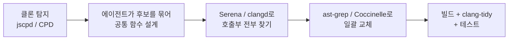

# 코딩 에이전트용 코드 이해·중복 탐지·리팩터링 도구

작성 기준일은 **2026-11-13**이다. CUBRID처럼 C/C++ 비중이 크고 규모가 큰 코드베이스에서 Claude Code나 Codex 같은 코딩 에이전트의 탐색, 리팩터링, 검증을 돕는 도구를 정리한다. 설치 여부는 환경마다 다르므로 이 문서는 도구의 존재와 용도만 기록한다. 이 중 다섯 도구를 실제로 돌려 본 결과는 [실사용 평가](2026-11-13-static-analysis-tool-trial.md)에 있다.

## 1. 핵심: 찾는 도구와 고치는 도구는 다르다

Serena 같은 코드 인텔리전스 서버는 LSP(C/C++에서는 clangd)로 심볼 단위 탐색과 편집을 한다. `find_symbol`, `find_referencing_symbols`, `replace_symbol_body` 같은 기능이 있다. **중복 함수를 찾는 기능은 없다.** 그래서 중복 제거는 두 단계로 나눈다.

- 찾기: 클론 탐지기(jscpd, PMD CPD 등)
- 고치기: Serena나 clangd로 참조를 전부 찾아 호출부를 정리

## 2. 코드 탐색과 이해

효과가 가장 큰 영역이다.

| 도구 | 용도 | 비고 |
| --- | --- | --- |
| [Serena](https://github.com/oraios/serena) (MCP) | 심볼 정의, 참조, 호출부를 정확히 찾고 심볼 단위로 편집 | Claude와 Codex 모두 MCP로 연결 가능. `uvx`로 바로 실행 |
| Claude Code LSP 플러그인 (clangd) | Serena 없이 정의 이동, 참조 찾기, 진단 | 공식 플러그인 마켓플레이스에서 설치. Claude 전용 |
| clangd 설정 튜닝 | `.clangd`로 불필요한 진단·경고를 끄고 background index 사용 | Serena와 LSP 플러그인 모두 결국 clangd 품질에 좌우됨 |
| GNU Global / universal-ctags | 빌드 없이 빠르게 심볼 인덱싱 | clangd 인덱싱이 느리거나 다른 브랜치를 볼 때 대안 |

대규모 코드베이스에서 주의할 점:

- clangd 첫 인덱싱은 오래 걸리고 메모리를 많이 쓴다.
- worktree마다 `.cache/clangd/index`가 따로 생긴다. worktree를 많이 쓰면 인덱스 위치 공유나 clangd remote index를 고려한다.
- Serena의 onboarding·memory 기능은 `CLAUDE.md`와 내용이 겹칠 수 있다. 끄거나 최소한으로 쓴다.

## 3. 중복 코드 탐지

| 도구 | 방식 | 특징 |
| --- | --- | --- |
| [PMD CPD](https://pmd.github.io/) | 토큰 기반, C/C++ 지원 | 오래 쓰인 표준 도구. `--ignore-identifiers`, `--ignore-literals`로 이름만 다른 복사본도 탐지 |
| [jscpd](https://github.com/kucherenko/jscpd) | 토큰 기반, 다언어 | npm으로 설치가 간단. HTML/JSON 리포트를 만들어 에이전트에게 넘기기 좋음 |
| NiCad / CCFinderSW | 구조 기반 near-miss 클론 | 연구용에 가깝지만 Type-2/3 클론(조금씩 다른 복사본)을 잘 잡음 |
| [lizard](https://github.com/terryyin/lizard) | 함수별 복잡도·길이 측정 | 중복 제거 후보의 우선순위를 정할 때 함께 사용 |

권장 흐름: jscpd나 CPD로 JSON 결과를 만든다. 에이전트가 후보를 묶어 공통 함수 설계를 제안한다. Serena나 clangd로 호출부를 전부 찾아 교체하고, 빌드와 테스트로 확인한다.

## 4. 구조 검색과 일괄 리팩터링

| 도구 | 용도 |
| --- | --- |
| [ast-grep](https://ast-grep.github.io/) | AST 패턴으로 검색·수정. grep보다 훨씬 정확한 일괄 수정 |
| [Coccinelle](https://coccinelle.gitlabpages.inria.fr/website/) (`spatch`) | C용 semantic patch. 리눅스 커널의 대규모 API 교체에 사용. 중복 패턴을 공통 함수 호출로 바꾸는 작업에 적합 |
| clang-query / clang-tidy custom check | AST matcher로 "이런 형태의 함수를 전부 찾아라" 같은 질의 |

## 5. 정적 분석 (에이전트가 만든 코드 검증)

| 도구 | 용도 | 비고 |
| --- | --- | --- |
| clang-tidy | 린트·버그 패턴 검사 | 전체 실행은 느리므로 변경 파일에만(`clang-tidy-diff`) |
| cppcheck | 가벼운 정적 분석 | 빌드 불필요 |
| [CodeQL](https://codeql.github.com/) | 데이터 흐름 질의. 예: "latch를 잡은 뒤 release 없이 return하는 경로" | 무겁지만 강력 |
| include-what-you-use | 헤더 의존성 정리 | 리팩터링 후 빌드 시간 단축 |

## 6. 빌드와 디버깅 루프 (에이전트 반복 속도)

- **ccache, mold, ninja**: 빌드 preset에서 실제로 쓰이는지 확인한다.
- **rr**: 기록 후 재생하는 디버거. 에이전트가 `rr replay` 안에서 gdb 배치 명령으로 비결정적 버그를 추적할 수 있다.
- **`ninja -t targets`와 단일 파일 컴파일**: 전체 빌드 없이 컴파일만 빠르게 확인한다.

## 7. 우선순위 제안

1. Serena MCP를 Claude와 Codex 양쪽에 연결한다. 효과 대비 비용이 가장 좋다.
2. 중복 탐지는 jscpd나 PMD CPD로 후보를 뽑고, 큰 C 코드 교체는 Coccinelle이나 ast-grep으로 한다.
3. 검증 단계에 변경 파일 대상 clang-tidy를 넣는다. hook이나 skill로 만들 수 있다.
